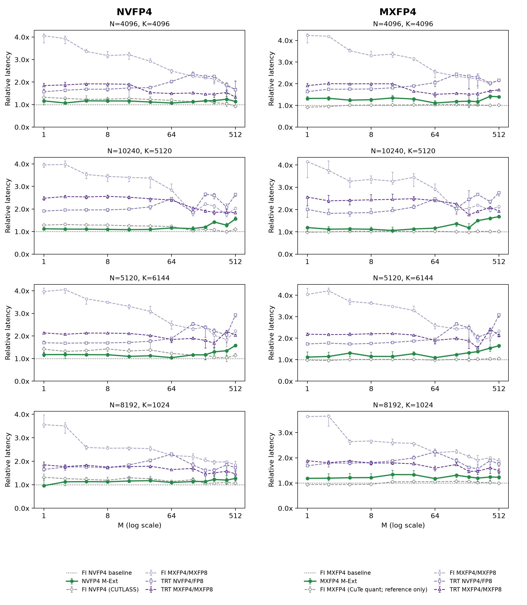
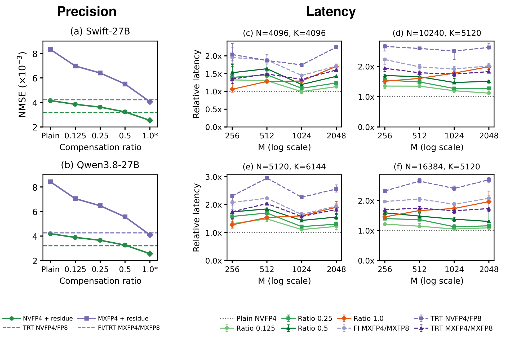
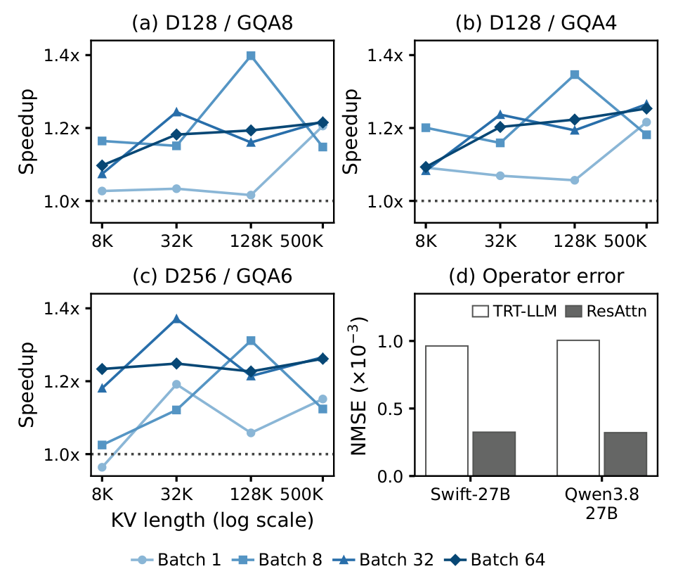

# ResServe

**Published: October 20, 2026**

ResServe is a framework for **accurate** and **efficient FP4 inference** on
NVIDIA Blackwell GPUs. It combines **residue error compensation** with
**fused GPU kernels** to reduce quantization error while keeping inference fast.

With **NVFP4 and MXFP4** linear kernels, **NVFP4 decode attention**, ModelOpt
export, FlashInfer autotuning and **vLLM integration**, ResServe connects
quantization research to practical model serving.

## ✨ Highlights

- **MEXT** compensates activation quantization error with a folded GEMM for
  small token batches, using NVFP4 or MXFP4.
- **KEXT** extends the activation and weight operands along K for selected
  residue channels. Ratio 1.0 uses the full-channel auto path.
- **ResAttn** applies residue compensation to paged NVFP4 decode attention.

<sub>NVFP4 Fold supports SM120 in addition to SM100; MXFP4 MEXT and ResAttn target SM100.</sub>

> ⭐ **Find ResServe useful?** Give us a star to support the project and help
> more people discover accurate and efficient FP4 inference. We welcome your
> feedback, issues and contributions!

## 📊 Kernel results

The figures below show operator measurements on a B200, not model throughput
or task accuracy. FI denotes FlashInfer; TRT denotes TensorRT-LLM kernels
exposed through FlashInfer.

### MEXT · NVFP4 and MXFP4

**Lower operator error:** MEXT reduces pooled NMSE by **16.6% with NVFP4**
and **20.3% with MXFP4** relative to their respective FI W4A4 baselines
on the captured Qwen3-32B inputs.

The latency comparison below groups **NVFP4 on the left** and **MXFP4 on the
right**. Green curves show MEXT; lower is faster.



<details>
<summary>Linear measurement details</summary>

The precision comparison uses 72 paired real inputs from Qwen3-32B and FP32
references. Each format's four latency panels show representative projection
shapes.

Linear latency plots show matched per-process ratios: lines are medians and
error bars are the full range across five sequential process runs. Performance
varies with shape and batch size.

MEXT trades a small residue computation for reduced FP4 operator error. Compare
its latency with both W4A4 and W4A8 controls; the W4A4 line is the normalization
baseline, not an accuracy-equivalent implementation. NVFP4 and MXFP4 use their
respective FI baselines.

**Linear timing boundary:** activation conversion/quantization and GEMM are
included; weight preparation is excluded. TRT NVFP4/FP8 uses a precomputed
per-tensor activation scale, so its scale estimation is excluded. FI/TRT
MXFP4/MXFP8 include online block quantization and scale generation. NVFP4
paths also use precomputed global scales. Linear measurements use CUDA Graphs
with rotating input buffers.

</details>

### KEXT · Precision and latency

Selective compensation controls the added computation by compensating a subset
of channels. **Left:** operator error at different ratios. **Right:** NVFP4
latency relative to plain FI NVFP4. Lower is better in both groups.



<details>
<summary>Selective compensation measurement details</summary>

Panels (a–b) show pooled linear NMSE on 192 matched prefill input groups per
model; `1.0*` marks full compensation. Panels (c–f) include online activation
quantization and GEMM, with the linear timing boundary described above. Timing
uses the FlashInfer `mm_fp4(backend="auto")` path with synthetic masks and
automatic selection for full compensation.

</details>

### ResAttn · Speedup and precision

ResAttn achieves up to **1.40×** speedup over TensorRT-LLM, with a median
speedup of **1.19×** across 48 configurations; it is faster in 47.
Panels (a–c) show speedup; panel (d) shows operator error against the native
BF16-output TRT-LLM baseline.



<details>
<summary>Attention measurement details</summary>

Panels (a–c) use identical BF16 queries and prepared page32 NVFP4 KV, with native
BF16 output from both kernels. Timing includes query conversion and attention,
excluding cache construction and KV append. Points show paired median
speedups across three independent processes using warm-buffer CUDA Graphs.
Panel (d) shows pooled NMSE against FP32 attention on the same dequantized KV,
using 192 paired real inputs per model from Swift-27B and Qwen3.8-27B. This
reference isolates attention computation error; lower NMSE is better.

</details>

## 🚀 Installation

Use Linux x86-64 and Python 3.12 with a compatible CUDA framework stack.
The runtime uses PyTorch, vLLM, FlashInfer and CUTLASS DSL.
Page32 attention requires a patched FlashInfer build with the matching
BF16-output kernel artifacts. Export additionally requires NVIDIA ModelOpt,
Transformers and the checkpoint's tokenizer dependencies.

NVFP4 Fold has SM100 and SM120 implementations. MXFP4 MEXT targets SM100.
ResAttn targets SM100 with head dimensions 128 or 256. Native quantization
build targets do not imply Fold/attention support for every GPU.

With Torch, CUDA build tools and the required libraries already installed:

```bash
python -m pip install --no-build-isolation --no-deps ./csrc
python -m pip install --no-deps -e .
python -m pip install --no-deps ./runtime/vllm_plugin
```

Set `NVFP4_BUILD_ARCHS=sm100` or `sm120` before building to target one GPU
architecture. Build the extension separately in each Torch environment;
CuTeDSL kernels compile on first use.

## 📦 Export a checkpoint

```bash
python -m export.export_nvfp4 \
  --source /path/to/bf16-model \
  --dataset /path/to/calibration.jsonl \
  --output /path/to/new-export \
  --mode residue --format nvfp4 --ratio 0.125 \
  --samples 1024 --seq-len 2048 --batch-size 4
```

The source is a local Hugging Face checkpoint. Each calibration JSONL row
contains `text` or chat `messages`; use the model's own chat template. The
output directory must be new. The checkpoint is written under `checkpoint/`.
Use `--mode preflight` with a separate output directory to check calibration
forward throughput first. Use `--mode plain` for an unextended FP4 export, or
`--format mxfp4` for MXFP4. Supported residue ratios are 0.125, 0.25, 0.5 and 1.0.
Run `--help` for the remaining options.

The exporter uses ModelOpt calibration with a uniform residue ratio.
AWQ, GPTQ and automatic layer-wise budget search are not included.

## ⚡ Serve with vLLM

Install the plugin as above; vLLM loads it in each worker. For a residue NVFP4
checkpoint:

```bash
export VLLM_PLUGINS=residue_patch
export RESIDUE_NVFP4=1
export RESIDUE_VLLM_MODEL_DIR=/path/to/new-export/checkpoint
export RESIDUE_PATCH_MODE=v2
vllm serve "$RESIDUE_VLLM_MODEL_DIR" --dtype bfloat16
```

For MEXT on a **plain NVFP4 checkpoint**, use the same command with
`RESIDUE_PATCH_MODE=mext_r1` and the plain checkpoint directory. Small-M Fold
and larger-M ratio1 prefill retain their automatic selection rules.

For MXFP4, unset `RESIDUE_NVFP4`, set `RESIDUE_MXFP4=1` and use a ModelOpt MXFP4
checkpoint. Its metadata determines the residue mode. Do not enable both
linear format gates for one model.
Set `RESIDUE_ENABLE_DECODE_MEXT=1` and `RESIDUE_DECODE_MEXT_MAX_M=128`
to enable small-M MEXT for plain or selective checkpoints. This is an M
threshold that also includes small prefill batches. Above it, MXFP4 uses
FlashInfer CuTeDSL GEMM with its original plain/selective quantization.

To enable ResAttn on a supported model, add `RESIDUE_ATTN=1` and vLLM options
`--attention-backend CUSTOM --kv-cache-dtype nvfp4 --block-size 32`.
Prefill uses TRT with direct BF16 output; ResAttn handles decode.
Set `RESIDUE_ATTN_BACKEND=trtllm` for the matched TRT BF16-output decode path.
The adapter supports mixed batches; full CUDA Graph support remains limited to
uniform single-token decode. The kernel plots above use BF16 attention output
without output-quantization fusion.

## 🗂️ Source layout

| Directory | Purpose |
| --- | --- |
| `csrc/` | Native FP4 quantization and CuTeDSL Fold/attention kernels |
| `quant/` | ModelOpt, FlashInfer and vLLM integrations |
| `export/` | Calibration and checkpoint export |
| `runtime/vllm_plugin/` | vLLM worker registration |

This distribution contains the core implementation and selected result figures.
Experiment orchestration, benchmark suites and raw evaluation data are not
included. The figures are measured snapshots, not a guarantee for every model
or environment.

## 🛠️ Roadmap

- [x] **MXFP4 kernels** — CuTeDSL GEMM and small-M MEXT for plain and selective checkpoints.
- [x] **Page32 attention** — updated ResAttn and a matched TRT path with direct BF16 output; retired legacy page128 ResAttn.
- [x] **Paper** — [Read on arXiv](https://arxiv.org/abs/2611.08713).
- [ ] **ResMoE** — currently under development and will be released soon.

## 📝 Citation

Read our [paper on arXiv](https://arxiv.org/abs/2611.08713).
To cite our work, use the following entry:

```bibtex
@misc{rong2026resserve,
  title = {{ResServe}: Accurate and Efficient {FP4} {LLM} Inference with Residue Compensation},
  author = {Shuo Rong and Ruibo Fan and Jiawen Wen and Xiaowen Chu},
  year = {2026},
  eprint = {2611.08713},
  archivePrefix = {arXiv},
  url = {https://arxiv.org/abs/2611.08713}
}
```

## 🙏 Acknowledgements

We thank Modal for providing free credits that enabled access to NVIDIA B200
GPUs for this project.

## ⭐ Star History

[](https://star-history.com/#ShawRong/ResServe&Date)

## 📄 License

Copyright © 2025–2026 Rong Shuo for ResServe original work and modifications.
Original work is licensed under Apache-2.0; third-party portions retain their
upstream rights and license conditions. See [LICENSE](LICENSE) and [NOTICE](NOTICE).
